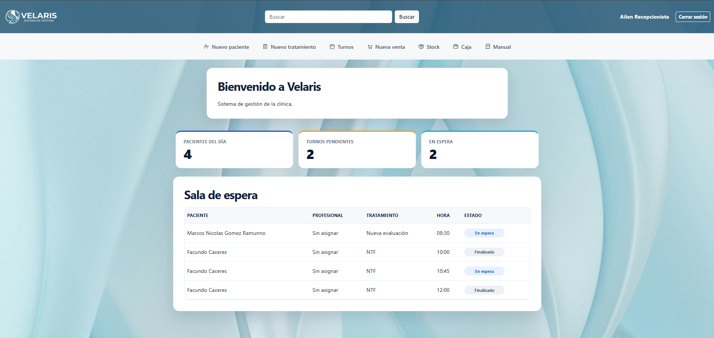
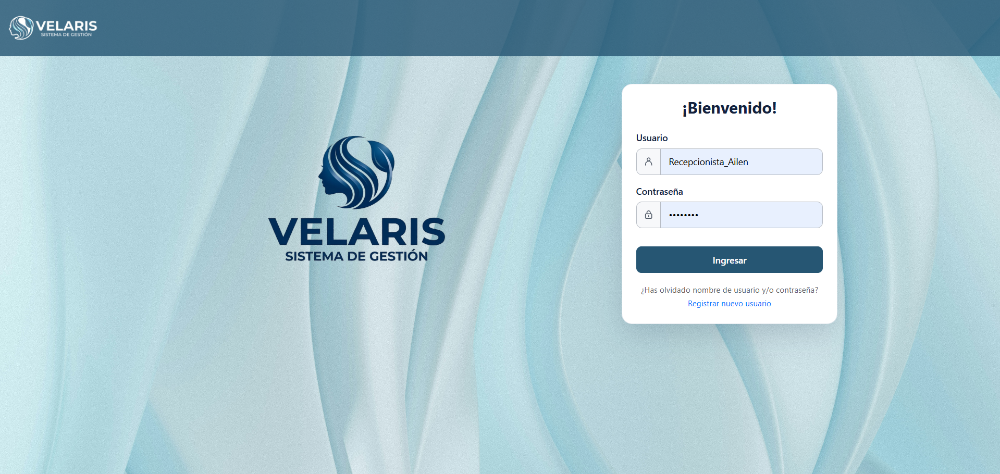
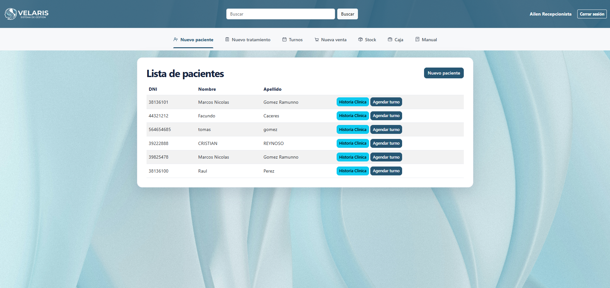
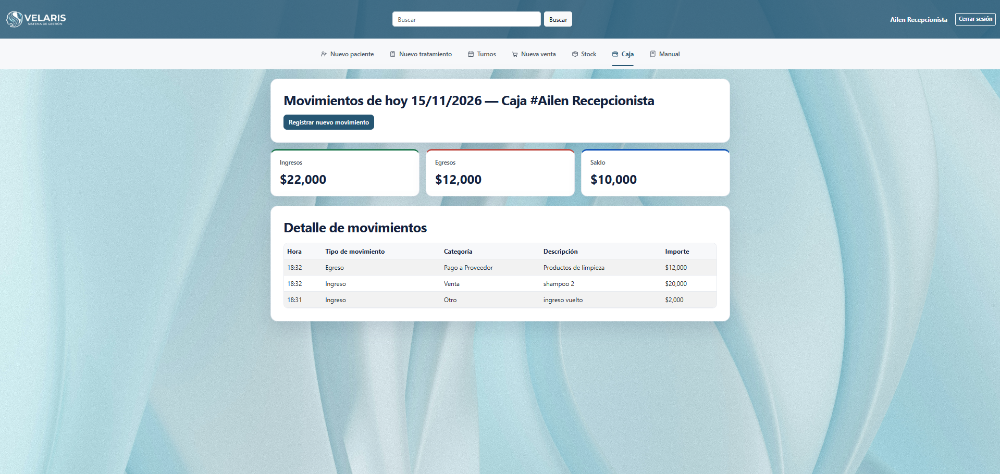
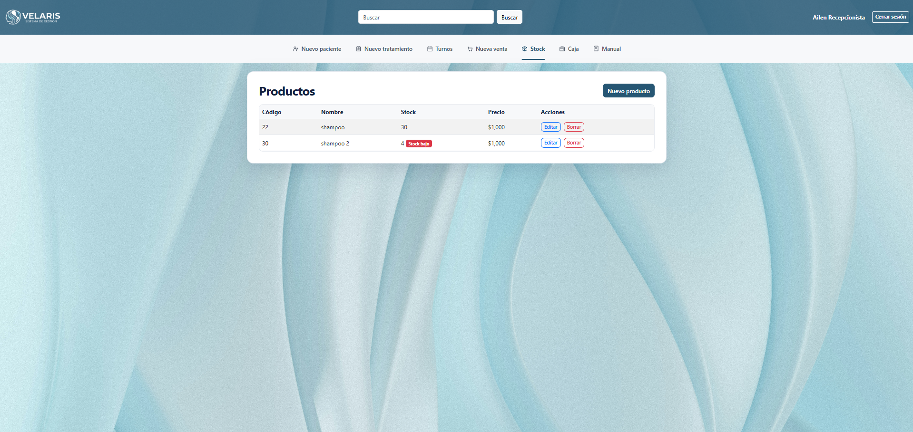
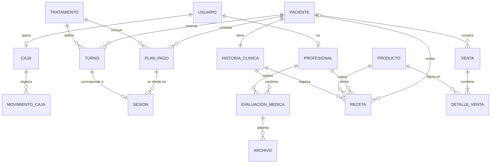

# Velaris — Sistema de gestión para clínica capilar

Sistema web de gestión para una clínica de estética capilar de Rosario. Velaris reúne en una sola plataforma lo que la clínica manejaba por separado: pacientes, historia clínica, agenda de turnos, tratamientos, caja y stock.

> **Proyecto académico** de la Tecnicatura Superior en Desarrollo de Software (Terciario Urquiza, Rosario), desarrollado en equipo para **Práctica Profesionalizante I** (2026) y con continuidad en **Práctica Profesionalizante II** (2027). La organización es real; todos los datos cargados son ficticios.

**Demo en línea:** [velaris-oqsm.onrender.com](https://velaris-oqsm.onrender.com/) · usuario de prueba a pedido
<sub>Alojada en el plan gratuito de Render: si estuvo inactiva, la primera carga puede tardar alrededor de un minuto.</sub>



---

## Estado del proyecto

🚧 **En desarrollo.** Primera etapa presentada en noviembre de 2026; la segunda se completa en 2027.

| Módulo | Estado |
|---|---|
| Inicio de sesión, usuarios y roles | ✅ Funcionando |
| Pacientes: alta, búsqueda, edición, baja y ficha | ✅ Funcionando |
| Historia clínica: evoluciones y evaluaciones médicas | ✅ Funcionando |
| Agenda de turnos y sala de espera | ✅ Funcionando |
| Tratamientos, planes de pago y sesiones | ✅ Funcionando |
| Caja: movimientos diarios de ingresos y egresos | ✅ Funcionando |
| Productos y stock | ✅ Funcionando |
| Ventas y facturación de productos y sesiones | 🔜 2027 |
| Recetas en PDF con código QR de validación | 🔜 2027 |
| Reportes: ventas, turnos, pacientes y productividad | 🔜 2027 |

---

## Funcionalidades

- **Usuarios y roles.** Autenticación y permisos por grupo según el puesto: CEO, Recepcionista, Médico, Enfermero, Instrumentador y Administrativo. Cada rol ve solo los menús y las secciones que le corresponden.
- **Pacientes.** Alta con validación de campos obligatorios, búsqueda por DNI, nombre o apellido, edición, baja con confirmación y ficha completa con pestañas de historia clínica, tratamientos y turnos.
- **Historia clínica.** Evoluciones y evaluaciones médicas asociadas al paciente y al profesional, con indicación de tratamiento.
- **Agenda de turnos.** Calendario mensual y semanal (FullCalendar) con cuatro agendas según la prestación: Consultorio, MTC (microtrasplante capilar), NTF (Nutrifol) y PRP (plasma rico en plaquetas). Asignación de turnos disponibles, control de superposición de horarios y seguimiento de estado: reservado, asignado, presente, completado, ausente o cancelado.
- **Sala de espera.** Pantalla de inicio con los pacientes del día y su estado.
- **Tratamientos y planes de pago.** Tratamientos con duración, cantidad de sesiones y precio por sesión; planes de pago por paciente y registro de sesiones.
- **Caja.** Caja por usuario con movimientos de ingreso y egreso por categoría (venta, proveedor, servicio, impuesto) y resumen del día.
- **Productos y stock.** Alta, edición y baja de productos y medicamentos, con alerta de stock mínimo.

<details>
<summary><b>Ver más capturas</b></summary>

| | |
|---|---|
|  |  |
|  |  |
|  |  |

</details>

---

## Tecnologías

| Capa | Tecnología |
|---|---|
| Backend | Python · Django 6.0 |
| Frontend | Plantillas de Django · HTML · CSS · Bootstrap 5 |
| Agenda | FullCalendar 6 |
| Formularios | django-crispy-forms + crispy-bootstrap5 |
| Base de datos | PostgreSQL (Neon) en producción · SQLite en desarrollo local |
| Despliegue | Render · Gunicorn · WhiteNoise para archivos estáticos |
| Configuración | Variables de entorno con python-dotenv y dj-database-url |
| Gestión del proyecto | Git y GitHub · Jira (Scrum) |

---

## Arquitectura

El proyecto está organizado **por dominio**: cada app de Django agrupa los modelos, vistas y plantillas de un área de la clínica. Las relaciones entre apps se declaran por referencia de texto (`"pacientes.Paciente"`) para evitar importaciones circulares.

```
velaris/
├── velaris/        # Configuración: settings, urls, wsgi
├── usuarios/       # Autenticación, roles y permisos, profesionales, caja y movimientos
├── pacientes/      # Pacientes, historia clínica, evoluciones, turnos y agenda
├── tratamientos/   # Tratamientos, planes de pago y sesiones
├── productos/      # Productos, stock y ventas
├── templates/      # Plantillas base y de inicio de sesión
├── static/         # Estilos e imágenes
├── docs/           # Modelo relacional (schema.sql) y capturas
├── build.sh        # Script de despliegue en Render
└── manage.py
```

---

## Modelo de datos

El diseño relacional tiene **16 entidades**. El script completo, con claves, restricciones y tipos, está en [`docs/schema.sql`](docs/schema.sql).



**Decisiones de diseño**

- **Claves naturales donde el identificador existe fuera del sistema** (`dni`, código de producto) y claves autoincrementales en las entidades internas.
- **`detalleVenta`** resuelve la relación muchos a muchos entre ventas y productos, y guarda la cantidad y el precio unitario al momento de la venta, para que un cambio de precio no altere ventas pasadas.
- **La venta admite paciente nulo**, para permitir ventas ocasionales a personas que no son pacientes.
- **Estados con valores cerrados** (estado del turno, estado de pago, método de pago, tipo de movimiento de caja) definidos como opciones del modelo y como `CHECK` en el esquema.
- **Borrado protegido** (`on_delete=PROTECT`) en las relaciones con datos clínicos o de caja, para que no se pierda información por un borrado en cascada.
- **Nomenclatura:** los documentos de diseño (DER, modelo relacional y diccionario de datos) usan camelCase; el código usa snake_case según PEP 8. La correspondencia es directa: `nombrePaciente` → `nombre_paciente`.

---

## Instalación local

**Requisitos:** Python 3.10 o superior y Git.

```bash
git clone https://github.com/marcosnicolasdev-code/velaris.git
cd velaris

python -m venv venv
source venv/Scripts/activate      # Windows con Git Bash
# source venv/bin/activate        # Mac o Linux

pip install -r requirements.txt
cp .env.example .env              # completar si hace falta
python manage.py migrate
python manage.py createsuperuser
python manage.py runserver
```

Abrir `http://127.0.0.1:8000`. El panel de administración está en `/admin`.

Con `DATABASE_URL` vacío en el `.env`, el proyecto usa SQLite y no hace falta instalar ninguna base de datos. Para trabajar con PostgreSQL, completar `DATABASE_URL` con la cadena de conexión (local o de Neon).

### Tests

```bash
python manage.py test
```

El proyecto tiene tests automatizados sobre permisos por rol, pacientes, turnos y agenda.

---

## Despliegue

La demo corre en **Render** con la base de datos en **Neon** (PostgreSQL), ambos en planes gratuitos.

- Cada merge a `main` dispara un despliegue automático.
- `build.sh` instala dependencias, recolecta los archivos estáticos y aplica las migraciones sobre la base de Neon.
- Las credenciales se configuran como variables de entorno en Render (`SECRET_KEY`, `DATABASE_URL`, `ALLOWED_HOSTS`, `DEBUG=False`). Ninguna se guarda en el repositorio.

---

## Forma de trabajo

- **Scrum con Jira:** backlog, sprints y registro de horas por tarea.
- **Git con ramas por funcionalidad** y pull requests revisados antes de integrarse a `main`.
- Relevamiento con la clínica, modelo entidad-relación, modelo relacional y diccionario de datos antes de implementar.

---

## Alcance

Fuera del alcance de este proyecto académico:

- Firma digital con validez legal en las recetas: se emite un PDF con número de receta y QR de validación propio.
- Facturación fiscal electrónica (ARCA): se emiten comprobantes internos.
- Aplicación móvil nativa.

---

## Equipo

| Integrante | Rol |
|---|---|
| **Marcos Nicolás Gómez Ramunno** · [@marcosnicolasdev-code](https://github.com/marcosnicolasdev-code) | Coordinación técnica y del repositorio, modelo de datos y desarrollo |
| **Ailén Martín Ciliberto** · [@40954611-png](https://github.com/40954611-png) | Análisis funcional y estructura de información |
| **Sofía Ailén Ponce** · [@So7i](https://github.com/So7i) | Documentación técnica y diagramas |
| **Cristian Iván Reynoso** · [@Cristiannivan](https://github.com/Cristiannivan) | Diseño de interfaz y experiencia de usuario |

Docente: **Diego Serván** · Terciario Urquiza, Rosario
